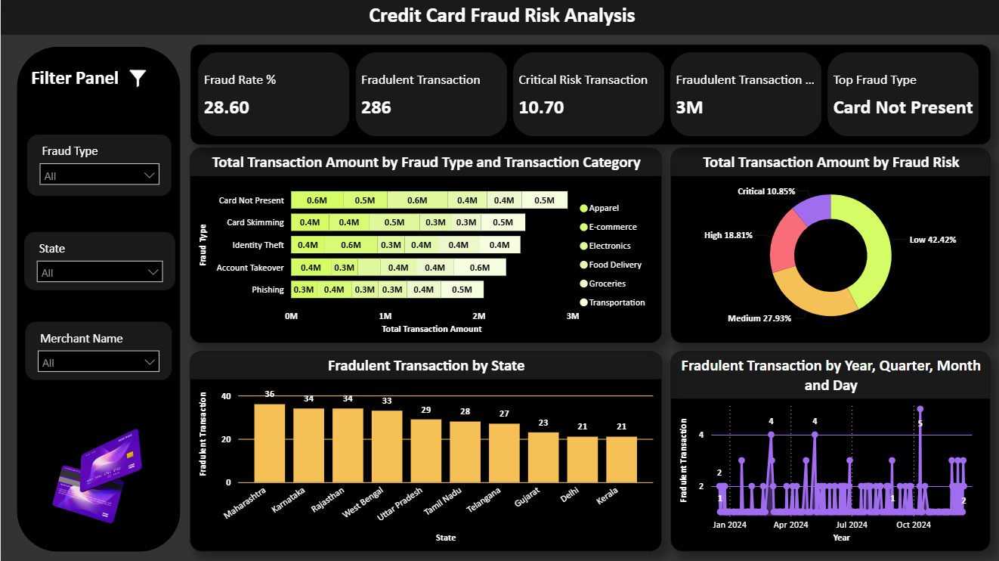

# 💳 Credit Card Fraud & Risk Analysis | Power BI Project

An interactive Power BI dashboard designed to analyse credit card transactions, identify fraudulent activities, uncover risk patterns, and generate actionable insights to support better financial decision-making.

---

## 📌 Project Overview

Credit card fraud is a major challenge for banks and financial institutions. Detecting suspicious transactions and understanding fraud patterns are essential for reducing financial losses and improving customer security.

This project focuses on analysing credit card transaction data to explore fraudulent activities, assess transaction risks, and visualize key fraud indicators through an interactive Power BI dashboard.

## 🎯 Business Objectives

- Analyse overall credit card transaction behaviour.
- Identify fraudulent transaction patterns and anomalies.
- Monitor fraud-related metrics and risk indicators.
- Understand transaction trends and high-risk activities.
- Support data-driven fraud prevention strategies.

## 🛠️ Tools & Technologies

| Tool | Purpose |
|---|---|
| Power BI | Dashboard development and visualization |
| Power Query | Data cleaning and transformation |
| DAX | Measures and KPI calculations |
| Excel / CSV | Dataset handling |

## 📊 Dashboard Preview

### Dashboard Overview

## 🔍 Key Analysis Areas

**1. Transaction Analysis**
- Explore transaction patterns and trends.
- Analyse transaction amounts and behaviour.
- Understand transaction distribution.

**2. Fraud Analysis**
- Examine fraudulent versus legitimate transactions.
- Identify unusual transaction patterns.
- Explore fraud trends across different categories.

**3. Risk Assessment**
- Monitor fraud-related risk indicators.
- Analyse high-risk transaction behaviour.
- Identify patterns that may require further investigation.

## 💡 Business Value

The dashboard helps banking and financial stakeholders:

- Monitor suspicious transaction patterns.
- Understand potential fraud exposure.
- Identify areas requiring further investigation.
- Make informed decisions using interactive visualizations.

## 📚 Key Learnings

- Understanding financial transaction data.
- Data cleaning and transformation using Power Query.
- Creating calculated measures using DAX.
- Designing interactive Power BI dashboards.
- Translating transaction data into meaningful business insights.

## 👩‍💻 About This Project

This project demonstrates my interest in banking and financial analytics, with a focus on transaction monitoring, fraud analysis, risk assessment, and business intelligence.

I aim to apply data analytics techniques to real-world banking challenges and develop actionable insights that support better business decisions.

